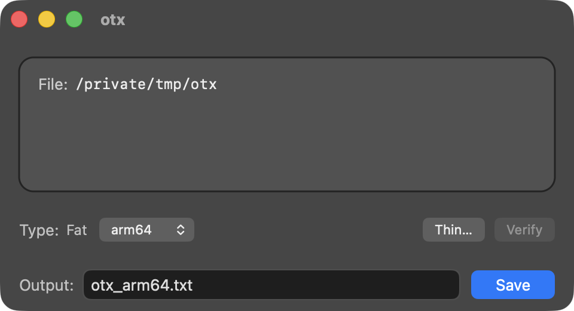

# otx

A Mach-O disassembler for macOS, supporting x86_64 and arm64 binaries. Available as both a GUI app and a command-line tool.



## Features

- Disassembles `__TEXT` sections of x86_64 and arm64 Mach-O binaries
- Resolves Objective-C class names and selectors in `objc_msgSend` call comments
- Demangles C++ symbols via `c++filt`
- Demangles Swift symbols via `libswiftDemangle` (requires Xcode)
- Annotates literal pool references, CFStrings, and data section pointers
- Displays local offsets, raw machine code, and field-aligned output
- Separates logical code blocks at branch targets
- Appends data section contents (`__DATA`, `__DATA_CONST`, etc.)
- Computes SHA-256 (or MD5 / SHA-1) checksum of the target binary
- Verifies and repairs obfuscated NOP sequences (x86_64)
- Output header with tool version, UTC generation timestamp, and target path
- Universal binary support via `-arch`

## Requirements

- macOS 12 or later
- Xcode (provides `otool` and `libswiftDemangle`)

## Building

Open `src/otx.xcodeproj` in Xcode and build the **otx gui** or **otx cli** scheme.

## CLI Usage

```
otx [-bcdCelmnoprvR] [-arch <arch>] <binary>
```

| Flag | Default | Description |
|------|---------|-------------|
| `-b` | off | Separate logical blocks with blank lines |
| `-c` | on  | Toggle SHA-256 checksum (off = no checksum) |
| `-C` | on  | Toggle display of raw machine code bytes |
| `-d` | off | Append data sections to output |
| `-e` | off | Disable entabbed (tab-aligned) output |
| `-l` | on  | Toggle local offsets |
| `-m` | on  | Toggle verbose `objc_msgSend` annotations |
| `-n` | on  | Toggle C++ / Swift symbol demangling |
| `-o` | —   | Check binary for obfuscated NOPs only (x86_64) |
| `-p` | off | Print progress to stderr |
| `-r` | on  | Toggle Obj-C method return types |
| `-R` | on  | Toggle return statements |
| `-v` | on  | Toggle Obj-C member variable types |
| `-arch x86_64 \| arm64` | host | Select a slice from a universal binary |

## Changelog

### 2.0.0

- **Dropped 32-bit and PPC support** — only x86_64 and arm64 are supported
- **Swift symbol demangling** — mangled `_$s…` names are demangled in function labels, operands, and comments via `libswiftDemangle` (loaded at runtime from the active Xcode toolchain)
- **Output file header** — every generated file now begins with the otx version, UTC generation timestamp, and the path of the analysed binary
- **Fixed bsearch comparison functions** — x86_64 code was using 32-bit comparison stubs; now uses the correct 64-bit variants
- **`<Deobfuscator>` protocol conformance** declared on `X8664Processor`
- **x86 decoding macros** consolidated into `X8664Processor.h`

### 1.x (Build 566 and earlier)

- Fix the Save menu (#4)
- Fix the Open menu (#3)
- No more symbolic link; minor UI fixes
- Updated base SDK to 10.9 / Xcode 5.1
- Initial release

## License

The otx project and all original otx source files are in the public domain.
